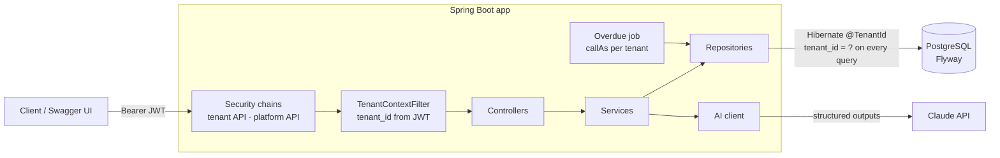

# invoicing-saas

Multi-tenant invoicing API for small businesses: customers, invoices with line
items, tax and discount, gapless invoice numbers, partial payments, overdue
tracking, a billing summary, and an AI feature that turns a pasted billing
request into a draft invoice.

Built with Java 21 and Spring Boot 3, **with an AI coding agent (Claude Code)**:
every change went through a plan I approved, a branch and a pull request that
records what I directed and what I corrected.

**Status:** MVP complete (15 PRs). Next: deployment and a TypeScript frontend.

### Highlights

- **Tenant isolation enforced in one place** (Hibernate `@TenantId`), fail-closed,
  no bypass; another tenant's data is a 404. Proven by isolation tests that fail
  7/7 when the filter is bypassed. → [write-up](docs/troubleshooting/cross-tenant-data-leak.md)
- **Gapless invoice numbers under concurrency** (row-locked counter, 20 parallel
  issues → exactly `0001..0020`), and a payment **lost update** found by a
  mutation check that a CHECK constraint didn't catch. → [write-up](docs/troubleshooting/invoice-numbering-race-condition.md)
- **Money done right**: `BigDecimal` end to end, HALF_UP per line then summed,
  money as JSON strings. → [write-up](docs/troubleshooting/money-precision-and-rounding.md)
- **AI with guard rails**: Claude output is untrusted, validated against a JSON
  schema and the same rules as manual entry, retried, never saved without review.
- **Operator features without a back door**: platform admins suspend tenants but
  only read tenant data with the tenant's time-limited, audited, read-only grant.
- **181 tests** on a real PostgreSQL (Testcontainers), including isolation,
  concurrency and mutation-checked tests; CI lints, tests and builds the image.

## Contents

- [Architecture](#architecture)
- [Quick start](#quick-start)
- [API overview](#api-overview)
- [Configuration](#configuration)
- [How it works](#how-it-works)
- [Testing](#testing)
- [Troubleshooting write-ups](#troubleshooting-write-ups)
- [Built with an AI agent](#built-with-an-ai-agent)
- [Limitations and next steps](#limitations-and-next-steps)

## Architecture



- **Stack:** Java 21 · Spring Boot 3.5 · Spring Security (stateless JWT, HS256) ·
  Spring Data JPA / Hibernate 6.6 · PostgreSQL 17 · Flyway · springdoc OpenAPI ·
  Anthropic Java SDK · JUnit 5 + Testcontainers · Docker · GitHub Actions ·
  Actuator + Micrometer (Prometheus)
- **Package layout:** by feature, then by kind:

```
io.github.dimasnurfauzi.invoicing
├── security/        config/ (two filter chains, JWT), jwt/
├── auth/            login, /api/me
├── user/            tenant users (ADMIN / STAFF)
├── tenant/          registration; context/ (TenantContext, filter, Hibernate resolver)
├── customer/  invoice/  payment/  summary/
├── ai/              client/ (Claude), service/ (draft, schema, validation, prompt)
├── platform/        SaaS operator: login, tenants, suspend
├── supportaccess/   tenant-granted, audited, read-only support access
└── common/          exception/, config/, web/, dto/
    each feature: controller/ service/ repository/ entity/ dto/ exception/ (as needed)
```

## Quick start

### Everything in Docker

```bash
cp .env.example .env                     # set JWT_SECRET (at least 32 bytes)
docker compose --profile app up --build
```

Then open <http://localhost:8080/swagger-ui.html>. Set `APP_PORT` if 8080 is
taken. The `app` service only starts with `--profile app`; a plain
`docker compose up -d` runs just PostgreSQL.

### Local development (IDE)

Prerequisites: JDK 21, Docker.

```bash
cp .env.example .env
docker compose up -d                     # PostgreSQL 17 on localhost:5433
set -a; source .env; set +a              # the app doesn't read .env itself
./mvnw spring-boot:run
./mvnw verify                            # Spotless lint + all tests (needs Docker)
```

In IntelliJ, put `JWT_SECRET=...` (and optionally the other variables) under
Run Configuration → Environment variables, without spaces after `;`.

<details>
<summary>Docker via Colima (macOS)</summary>

Testcontainers looks for `/var/run/docker.sock`. With Colima:

```bash
export DOCKER_HOST=unix://$HOME/.colima/default/docker.sock
export TESTCONTAINERS_DOCKER_SOCKET_OVERRIDE=/var/run/docker.sock
```

(Or put `docker.host=unix:///Users/<you>/.colima/default/docker.sock` in
`~/.testcontainers.properties`.)
</details>

### Try it

In Swagger UI: `POST /api/tenants` (public) → `POST /api/auth/login` →
**Authorize** with the `accessToken` → create a customer → create an invoice →
issue it → record a payment → `GET /api/summary`.

```bash
curl -X POST localhost:8080/api/tenants -H 'Content-Type: application/json' \
  -d '{"tenantName":"Toko Maju","tenantSlug":"toko-maju","adminEmail":"owner@tokomaju.test","adminPassword":"TokoMaju-123"}'
curl -X POST localhost:8080/api/auth/login -H 'Content-Type: application/json' \
  -d '{"tenantSlug":"toko-maju","email":"owner@tokomaju.test","password":"TokoMaju-123"}'
curl localhost:8080/api/me -H "Authorization: Bearer <accessToken>"
```

## API overview

All endpoints need a tenant token unless marked public. Money is sent and
returned as decimal strings. Errors are RFC 9457 `ProblemDetail`. Lists are paged
(`page`, `size` ≤ 100).

| Area | Endpoints | Notes |
|---|---|---|
| Sign-up & login | `POST /api/tenants` (public), `POST /api/auth/login` (public), `GET /api/me` | Login is tenant slug + email + password; signup can be turned off |
| Users | `GET/POST /api/users`, `GET/PATCH/DELETE /api/users/{id}` | Writes ADMIN only; an admin can't demote or delete themselves |
| Customers | `GET/POST /api/customers`, `GET/PUT/DELETE /api/customers/{id}`, `POST …/{id}/restore` | `q` search; delete = archive (ADMIN) |
| Invoices | `GET/POST /api/invoices`, `GET/PUT/DELETE /api/invoices/{id}` | Drafts only for PUT/DELETE; totals always computed |
| Issue / void | `POST /api/invoices/{id}/issue`, `POST /api/invoices/{id}/void` | Issue assigns `INV-<year>-NNNN`; void ADMIN only, keeps the number |
| Payments | `GET/POST /api/invoices/{id}/payments` | Partial payments; PAID at zero balance; no overpayment |
| Summary | `GET /api/summary?from=&to=` | Per currency: billed, paid, outstanding, overdue, counts |
| AI drafts | `POST /api/invoices/ai-draft` | Returns a draft for review; nothing saved |
| Support access | `GET/POST /api/support-access`, `DELETE …/{id}`, `GET …/logs` | Tenant ADMIN grants 1–72 h, revokes, audits |
| Platform admin | `POST /api/platform/auth/login` (public), `GET/POST /api/platform/tenants`, `POST …/{id}/suspend`, `…/activate`, `GET …/{id}/support/{users,customers,invoices}` | Separate token type; support reads need a grant + `reason` |
| Ops | `GET /actuator/health` (public), `/actuator/info`, `/actuator/prometheus` | Every response has `X-Request-Id` |

## Configuration

All configuration is environment variables (documented in
[`.env.example`](.env.example)); no secrets in the repo.

| Variable | Default | Purpose |
|---|---|---|
| `JWT_SECRET` | — (required) | HS256 signing key, ≥ 32 bytes; the app won't start without it |
| `JWT_TTL` | `PT1H` | Access token lifetime |
| `DB_URL`, `DB_USERNAME`, `DB_PASSWORD` | local compose DB | Database connection |
| `POSTGRES_*`, `APP_PORT` | see `.env.example` | Docker Compose |
| `PLATFORM_ADMIN_EMAIL`, `PLATFORM_ADMIN_PASSWORD` | empty | First platform admin, created at startup if both set (password 12–72 chars) |
| `TENANT_SIGNUP_ENABLED` | `true` | Public tenant sign-up; `false` = only platform admins create tenants |
| `OVERDUE_CRON`, `OVERDUE_ZONE` | `0 5 0 * * *`, `Asia/Jakarta` | Overdue job schedule (`-` disables) |
| `ANTHROPIC_API_KEY` | empty | Enables AI drafts (503 without it) |
| `AI_MODEL`, `AI_EFFORT` | `claude-opus-5-5`, `low` | Claude model and effort |
| `CORS_ALLOWED_ORIGINS` | empty (off) | Exact browser origins allowed to call the tenant API, comma-separated (e.g. `http://localhost:5173`); never wildcards; platform API excluded |
| `SPRINGDOC_ENABLED` | `true` | Swagger UI / OpenAPI spec; set `false` in production |

## How it works

**Multi-tenancy.** The tenant comes only from the validated JWT's `tenant_id`
claim, never from the request. `TenantContextFilter` puts it in a `ThreadLocal`
and clears it in `finally`; Hibernate's `@TenantId` adds the tenant condition to
every query (including `findById`) and stamps inserts. With no tenant in context
nothing matches. Jobs and pre-authentication flows run inside
`TenantContext.callAs(tenantId, …)`. A guard test fails the build if a table has
an unindexed or nullable `tenant_id`, or an entity forgets `@TenantId`.

**Invoices and money.** `InvoiceCalculator` computes subtotal → discount → tax
on the discounted amount → total per line (HALF_UP, scale 2), and invoice totals
as sums of the stored line amounts. Lifecycle: DRAFT → SENT → PAID, OVERDUE by a
daily job, VOID for cancelled sent invoices; transitions are centralized in
`InvoiceStatus`. Anything that changes an invoice's status or amounts locks the
invoice row first.

**Numbering.** Issuing locks the invoice, then the `(tenant, year)` counter
(`SELECT … FOR UPDATE`, always in that order), increments it and marks the
invoice SENT in one transaction: concurrent issues are serialized and a failure
rolls the number back. Drafts have no number.

**AI drafts.** The pasted text (and today's date, nothing else) goes to Claude
with structured outputs constrained to
[`ai/invoice-draft.schema.json`](src/main/resources/ai/invoice-draft.schema.json).
The reply is parsed, validated against the same schema, then against the
manual-entry line rules; failures are retried with the errors in the prompt (3
attempts), then 502. The customer is matched locally by exact name within the
tenant. The result has the shape of `POST /api/invoices`, so saving goes through
the normal validation. Tests replace the model with a scripted fake.

**Platform admin and support access.** The SaaS operator has its own account
table, login and token (`scope=platform`, no `tenant_id`) on a separate security
chain; tenant and platform tokens can't cross. Suspending a tenant blocks login
and existing tokens immediately. Reading tenant data for support requires an
active grant from the tenant's ADMIN, a reason, writes an audit log first, and
runs in a read-only transaction (PostgreSQL rejects writes).

## Testing

```bash
./mvnw verify           # Spotless + 181 tests on PostgreSQL in Testcontainers
```

- **Integration tests over real HTTP and PostgreSQL** (no H2, no mocked
  database), one shared container per run.
- **Isolation tests for every tenant-owned resource** (users, customers, invoices
  and lines, payments, support grants/logs, summary): two real tenants, 404
  bodies compared byte for byte, the other tenant's rows checked with JDBC below
  the filter.
- **Concurrency tests** with a latch so requests really race: parallel invoice
  issuing (unique, gapless) and parallel payments (never overpaid).
- **Unit tests** for money math, number format, status transitions, summary
  aggregation, AI output validation.
- **Mutation checks** (fix removed temporarily, test must fail): tenant filter
  bypassed (7/7 isolation tests fail), tenant context not cleared, numbering lock
  removed (duplicates), payment lock removed (lost update, 10/10 accepted).
- **CI** (GitHub Actions): Spotless, `./mvnw verify`, then a Docker image build.

## Troubleshooting write-ups

- [Preventing a cross-tenant data leak](docs/troubleshooting/cross-tenant-data-leak.md):
  `@TenantId` vs `@Filter` vs RLS, fail-closed tenant context, 404 not 403,
  isolation tests that fail 7/7 when the filter is bypassed.
- [Race conditions: invoice numbering and payments](docs/troubleshooting/invoice-numbering-race-condition.md):
  why `MAX()+1` and sequences don't give gapless numbers, a row-locked counter,
  and a lost update in partial payments that a CHECK constraint didn't catch.
- [Money precision and tax rounding](docs/troubleshooting/money-precision-and-rounding.md):
  `BigDecimal` end to end, HALF_UP per line then summed (and the case where it
  changes the total), money as JSON strings.

## Built with an AI agent

I worked with Claude Code as a pair: the agent follows [`CLAUDE.md`](CLAUDE.md)
(non-negotiable rules for multi-tenancy, money, numbering, security and the AI
feature), proposes a plan, and only codes after I approve or correct it. Each PR
uses the [PR template](.github/pull_request_template.md): what I directed, what
I corrected, how it was tested, and an explicit list of changes in the
security-sensitive packages, which I review line by line.

| PR | Change |
|---|---|
| [#1](https://github.com/dimas-nurfauzi/invoicing-saas/pull/1) | Skeleton: Spring Boot, PostgreSQL compose, Flyway, Testcontainers, CI |
| [#2](https://github.com/dimas-nurfauzi/invoicing-saas/pull/2) | Tenant registration with the first ADMIN user |
| [#3](https://github.com/dimas-nurfauzi/invoicing-saas/pull/3) | Stateless JWT auth and login |
| [#4](https://github.com/dimas-nurfauzi/invoicing-saas/pull/4) | Centralized tenant filter (`@TenantId`), isolation tests, Swagger |
| [#5](https://github.com/dimas-nurfauzi/invoicing-saas/pull/5) | Platform admin, tenant suspension, request ids |
| [#6](https://github.com/dimas-nurfauzi/invoicing-saas/pull/6) | Tenant-granted, audited, read-only support access |
| [#7](https://github.com/dimas-nurfauzi/invoicing-saas/pull/7) | Customer CRUD with archive, paging and search |
| [#8](https://github.com/dimas-nurfauzi/invoicing-saas/pull/8) | Draft invoices with line items, tax and discount |
| [#9](https://github.com/dimas-nurfauzi/invoicing-saas/pull/9) | Issue and void with gapless per-tenant numbering |
| [#10](https://github.com/dimas-nurfauzi/invoicing-saas/pull/10) | Partial payments |
| [#11](https://github.com/dimas-nurfauzi/invoicing-saas/pull/11) | Overdue job and per-currency summary |
| [#12](https://github.com/dimas-nurfauzi/invoicing-saas/pull/12) | AI invoice drafts via Claude |
| [#13](https://github.com/dimas-nurfauzi/invoicing-saas/pull/13) | Troubleshooting write-ups |
| [#14](https://github.com/dimas-nurfauzi/invoicing-saas/pull/14) | Docker image, full-stack compose, image build in CI |
| [#15](https://github.com/dimas-nurfauzi/invoicing-saas/pull/15) | Package structure by feature and kind |

Some things that came from my side rather than the agent's plan: Swagger for
manual testing; a platform admin for the app owner; support access so the dev
team can debug client data without a back door; running manual checks in
batches; the controller/service/dto/entity package split.

## Limitations and next steps

Deliberately out of the MVP:

- No refresh tokens or logout; access tokens live 1 hour (a deleted user's token
  works until it expires; a suspended tenant's tokens stop immediately).
- No rate limiting yet on login, sign-up or the AI endpoint (cost control).
- No self-service password change or reset, no email invitations.
- Payments are append-only (no reversal or refund yet); no invoice-level discount.
- No optimistic locking on customer edits (last write wins).
- Single region, single instance assumed for the overdue job (safe but redundant
  if several instances run it).
- The AI feature has only been tested against a scripted model in CI.

Next: deployment with a public demo, then a TypeScript frontend (React + Vite)
focused on the AI draft review flow.
